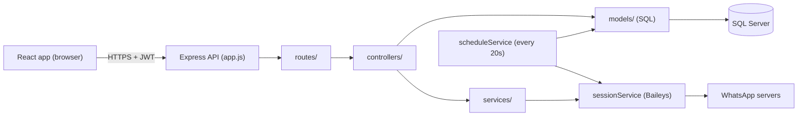

# WaDesk — WhatsApp Bulk Messaging Panel

Complete technical and functional documentation.

---

## Table of contents

1. [What this project does](#1-what-this-project-does)
2. [Technology stack](#2-technology-stack)
3. [Architecture](#3-architecture)
4. [Folder structure](#4-folder-structure)
5. [Users, roles and permissions](#5-users-roles-and-permissions)
6. [Pages and features](#6-pages-and-features)
7. [How sending works](#7-how-sending-works)
8. [Scheduled campaigns](#8-scheduled-campaigns)
9. [Personalization](#9-personalization)
10. [Message gap (min / max)](#10-message-gap-min--max)
11. [Backend API reference](#11-backend-api-reference)
12. [Database](#12-database)
13. [Configuration (.env)](#13-configuration-env)
14. [Running locally](#14-running-locally)
15. [Production deployment (IIS)](#15-production-deployment-iis)
16. [Security](#16-security)
17. [Troubleshooting](#17-troubleshooting)
18. [Known limitations](#18-known-limitations)

---

## 1. What this project does

WaDesk is a web panel for sending WhatsApp messages from one or more linked WhatsApp numbers. A team logs in, links WhatsApp numbers by scanning a QR code (or entering a pairing code), and then:

- sends a single message (with optional media) to one number,
- runs bulk campaigns to many numbers with live progress, pause, resume and stop,
- sends personalized bulk messages from an Excel sheet (`Namaste {{name}}, ...`),
- schedules campaigns to be sent automatically at a future date and time,
- controls the random delay between messages to reduce the risk of the number being banned,
- reviews history and per-number results of every campaign.

> **Important:** WhatsApp is connected through an **unofficial** library (Baileys), not the official WhatsApp Business API. WhatsApp may restrict or ban numbers that send too many messages. Use realistic gaps and send only to people who expect your messages.

---

## 2. Technology stack

| Layer | Technology |
|---|---|
| Frontend | React 19 (Create React App), React Router 7, `xlsx` for Excel import |
| Backend | Node.js, Express 5 |
| WhatsApp | `@whiskeysockets/baileys` (WhatsApp Web protocol) |
| Database | Microsoft SQL Server via `mssql` + `msnodesqlv8` (ODBC Driver 18, Windows only) |
| Auth | JWT (`jsonwebtoken`), passwords hashed with `bcryptjs`, optional Google Sign-In |
| Browser | Puppeteer / Chrome (used for rendering media such as voter slips) |
| Hosting | Windows server with IIS + iisnode (current live setup) |

---

## 3. Architecture



- The backend follows **Routes → Controllers → Models / Services**. Routes are thin; controllers validate input and call models (database) and services (WhatsApp, sending, scheduling).
- In production the same Express process also serves the built React files, so the whole app runs on **one port and one domain**.
- WhatsApp sessions live **inside the backend process**. Only **one** backend instance may run per WhatsApp number (see [Troubleshooting](#17-troubleshooting)).

---

## 4. Folder structure

```
wtsp/
├── backend/
│   ├── app.js                 Entry point: middleware, routes, startup, scheduler
│   ├── web.config             IIS / iisnode configuration
│   ├── .env                   Secrets and settings (never commit / never make public)
│   ├── config/index.js        Reads .env into a config object, validates required values
│   ├── routes/                URL → controller mapping
│   ├── controllers/           Request handling and validation
│   ├── models/                SQL Server queries (users, devices, campaigns, automation, templates)
│   ├── services/
│   │   ├── sessionService.js  WhatsApp connections, QR, pairing code, reconnect
│   │   ├── sendService.js     Sending text / media to a chat
│   │   ├── scheduleService.js Background scheduler for scheduled campaigns
│   │   └── browserService.js  Locates or installs Chrome for Puppeteer
│   ├── middleware/auth.js     authenticate, requireRole, requireDeviceAccess
│   ├── utils/
│   │   ├── personalize.js     {{variable}} templates, recipient parsing, country code
│   │   ├── gap.js             Min / max gap validation and random delay
│   │   ├── paths.js           Folder paths, upload cleanup
│   │   ├── helpers.js         Phone formatting, sleep, misc
│   │   ├── media.js           Media wrapper for attachments
│   │   └── webhooks.js        Optional external webhook logging
│   ├── sql/                   Database setup scripts (schema.sql, setup.js, ...)
│   ├── lib/                   Older modules; only used by sql/setup.js
│   ├── .baileys_auth/         WhatsApp login data per number (created at runtime)
│   ├── uploads/               Uploaded attachments (auto-cleaned)
│   └── devices.json           Registry of linked numbers (created at runtime)
└── frontend/
    ├── .env                   REACT_APP_API_URL (backend URL used at build time)
    ├── src/
    │   ├── App.js             Routes
    │   ├── api.js             fetch wrapper, JWT storage, auto-logout on 401
    │   ├── auth/AuthContext.js Login state
    │   ├── component/         Layout, Header, sidebar, ProtectedRoute
    │   ├── page/              One file per page (see section 6)
    │   └── index.css          All styles
    └── build/                 Production build (npm run build)
```

---

## 5. Users, roles and permissions

There are two roles.

| Capability | Admin | Operator |
|---|---|---|
| See all WhatsApp devices | Yes | Only devices assigned to them or added by them |
| Link a new WhatsApp number | Yes | Yes (the number is automatically assigned to them) |
| See who added each device | Yes | No |
| Send / campaigns / schedule | All devices | Only their devices |
| See campaigns and history | All users' campaigns | Only their own |
| Manage users (Users page) | Yes | No |

**Login methods**

- **Email / username + password.** Passwords are stored as bcrypt hashes.
- **Google Sign-In** (optional). Enabled when `GOOGLE_CLIENT_ID` is set. A first-time Google user is created as an **operator**. `GOOGLE_ALLOWED_DOMAIN` can restrict which email domain may sign in.
- **API key.** A request with header `x-api-key: <API_KEY>` is treated as an admin. Intended for server-to-server integrations; keep it secret.

**First admin:** on every start the backend makes sure an admin exists, using `ADMIN_USERNAME`, `ADMIN_PASSWORD` and `ADMIN_EMAIL` from `.env`.

**Sessions:** after login the browser stores a JWT (`wa_token` in `localStorage`) and sends it as `Authorization: Bearer <token>`. The token expires after `JWT_EXPIRES_IN` (default **8h**). When it expires, any API call returns 401 and the app sends the user back to the login page.

---

## 6. Pages and features

| Sidebar name | URL | File |
|---|---|---|
| Overview | `/` | `page/Dashboard.js` |
| Devices | `/devices` | `page/allDevices.js` |
| Single Message | `/compose` | `page/sendMessage.js` |
| Bulk Campaign | `/campaigns` | `page/bulkSend.js` |
| Bulk Personalize | `/personalize` | `page/Personalize.js` |
| Templates | `/templates` | `page/Templates.js` |
| Contacts | `/contacts` | `page/Contacts.js` |
| Automation | `/automation` | `page/Automation.js` |
| History | `/history` | `page/History.js` |
| Users (admin only) | `/users` | `page/Users.js` |
| Privacy | `/privacy` | `page/Privacy.js` |
| Login | `/login` | `page/Login.js` |

### 6.1 Overview

- Four stat cards: linked devices (and how many are live), messages sent today, total campaigns (and today's), total failed.
- "Last 7 days" bar chart of sent vs failed messages.
- The 5 most recent campaigns with status and counts; "New campaign" button opens Bulk Campaign.
- Responsive: on phones the stat cards show 2 per row and the table scrolls horizontally.

### 6.2 Devices

- **Link WhatsApp:** choose India (10 digits) or Dubai (9 digits), enter the number, press **Show QR**. A QR code appears; scan it from WhatsApp → Linked devices.
- **Connect with code instead:** shows an 8-character pairing code to type into WhatsApp instead of scanning.
- Status badges: `INITIALIZING`, `WAITING_FOR_QR`, `CONNECTING`, `CONNECTED`, `DISCONNECTED`.
- **Reconnect** for a disconnected device, **Remove** to unlink and delete it.
- Admins see "Added by" for each device.
- **Refresh behaviour:** the list is loaded when the page opens. After adding, reconnecting or requesting a code, it refreshes every 2.5 s only while a QR / pairing is pending, and stops as soon as the device is connected or disconnected (or after 3 minutes). It also pauses while the browser tab is hidden.

### 6.3 Single Message

- Pick a connected device, enter one number, a message and optional file, and send.
- Shows a count of messages sent from this page.

### 6.4 Bulk Campaign

- **Campaign name**, **Device**, **Numbers** (one per line or comma separated).
- **Import CSV:** reads `.csv` / `.txt` / `.tsv`, finds the phone column (header like `phone`, `mobile`, `whatsapp`, `contact`, `number`), removes duplicates (last 10 digits) and invalid rows, and merges into the list.
- **Message** and optional **File** (sent as an attachment; the message becomes its caption).
- **Min gap / Max gap (seconds):** random delay between messages (see [section 10](#10-message-gap-min--max)).
- **Live send:** *Start live send*, *Pause*, *Resume*, *Stop*. Each result streams into **Live log** as it happens.
- **Schedule for later:** tick the box, pick date and time (at least 1 minute ahead), press **Schedule campaign** (see [section 8](#8-scheduled-campaigns)).
- **Scheduled** list: upcoming campaigns with **Cancel**; running / recently finished ones show **Progress %**, success % and failed % with a green / red bar.
- Responsive: on screens under 900 px the form and the log stack vertically; buttons become 2 per row on phones.

### 6.5 Bulk Personalize

Same controls as Bulk Campaign (device, file, gap, live send, schedule, scheduled list), but recipients come from an **Excel** file and the message can contain variables.

- **Import Excel** (`.xlsx` / `.xls`), first sheet. Row 1 should be headers, e.g. `phone | name | village`.
- The page lists the available variables (`{{name}}`, `{{village}}`, ...) and shows a **Preview** of the message for the first contact.
- See [section 9](#9-personalization).

### 6.6 Templates

Reusable messages that can be sent to an Excel contact list.

- **Limit:** each user can create at most **5** templates (counter "x / 5 used"). Users see and use only their own templates.
- **Template content:** name, message text with `{{variables}}`, one optional image and one optional file (PDF, video, audio, Word, Excel, PowerPoint, text). At least text, image or file is required.
- **Send using template:** pick a template and a connected device, import an Excel file (row 1 = headers: `phone`, `name`, plus one column per variable), set min / max gap, then *Start send* with Pause / Resume / Stop and a live log. The page warns when a template variable has no Excel column (it would be sent empty) and shows a preview for the first contact.
- **Delivery:** the image is sent first with the personalized text as caption, then the file. Each send is saved as a campaign named `Template: <name>` (or the custom campaign name) and appears in History.
- **Files** are stored in `backend/uploads/templates/` (not touched by the 24-hour upload cleanup); files no longer used by any template are removed about an hour after a template is edited or deleted.

### 6.7 Automation (auto reply)

Automatic replies to incoming WhatsApp messages based on keywords.

- **Rule fields:** name, device, trigger (*Exact match*, *Contains*, *Starts with*), keywords (comma or new line, e.g. `hello, hi, price, help`), reply message, priority, active on / off.
- **Matching:** case-insensitive and extra spaces are ignored. *Exact* = whole message equals a keyword; *Contains* = keyword appears anywhere; *Starts with* = message begins with the keyword.
- **Options (menu):** a rule can have up to 20 options, each with its own reply (e.g. Bike, Car, Truck, Bus, Jeep). The reply message is sent with a numbered list (`1. Bike`, `2. Car`, ...). The customer answers with the number (`1`) or the name (`bike`, case-insensitive) and gets that option's reply. The menu stays open for 30 minutes per chat; any other message is handled by normal rules. Option replies support all variables plus `{{option}}` (the chosen option name). Stored as JSON in `AutomationRules.Options`. Open menus are kept in memory, so a backend restart closes them.
- **Working hours:** a rule can be limited to a time range (India time, `Asia/Kolkata`) and selected weekdays, e.g. 10:00–19:00 Mon–Sat. Overnight ranges such as 22:00–06:00 are supported. Outside working hours the rule sends its optional "reply outside working hours" (no file or menu; variables work), or, if that is empty, the rule is skipped and lower-priority rules are checked. Log entries show `(outside working hours)`. Stored as JSON in `AutomationRules.WorkingHours`.
- **Reply files:** the rule reply and every option reply can carry one image, video or PDF (uploaded with `POST /api/automation/upload`). The reply text becomes the caption; the text may be empty when a file is attached. Files are stored in `backend/uploads/automation/`, which the 24-hour upload cleanup does not touch; files no longer used by any rule are removed about an hour after a rule is edited or deleted.
- **Priority:** active rules of the device are checked from the highest priority number down; only the **first** matching rule replies.
- **Variables in the reply:** `{{name}}` (customer's WhatsApp name), `{{phone}}`, `{{message}}` (what the customer wrote). Example: `Hello {{name}} 👋 How can we help you?`
- **Custom variables:** each rule can define its own `key = value` pairs (e.g. `price = 499`, `address = Surat`) and use them as `{{price}}`, `{{address}}`. Keys: letters, numbers and `_`, up to 30 per rule; `name`, `phone` and `message` are reserved. Stored as JSON in `AutomationRules.Variables`.
- **Edit / Delete / enable-disable:** buttons in the Rules table; click the status badge to toggle.
- **Execution logs:** every auto reply (success or failed with error) with time, rule, keyword, customer, received text and reply. Filter by rule and refresh.
- **Safety:** only new text messages from individual chats are answered (not groups, status, own messages or old history). One chat gets at most one auto reply per 10 seconds to avoid reply loops. Rules are cached for 30 seconds and the cache is cleared when a rule is changed.
- The device must be connected (backend running) for replies to be sent.

### 6.8 History

- All campaigns (admin: everyone's, operator: own) with search by name, device, status, message, phone number or error text.
- Open a campaign to see the result for every number (success / failed and the error message).

### 6.9 Users (admin only)

- Create, edit and delete users: name, username / email, password, role (admin or operator).
- For operators, choose which devices they can use.
- The last remaining admin cannot be demoted or deleted.

### 6.10 Privacy

Policy text and the notice that the WhatsApp connection is unofficial.

### 6.11 Contacts

Saved customer list with groups. Every user has their own contacts and groups (admins also see only their own).

- **Upload list:** Excel or CSV, row 1 = headers: `phone`, `name`, plus any extra columns (`city`, `product`, ...) which are saved as details. A preview shows valid numbers, removed duplicates and skipped rows before importing. 10-digit numbers get `91` in front; leading zeros are removed. Large files are sent in parts of 2,000 rows with a progress bar.
- **Re-upload:** a number that already exists is updated (name and details are replaced only when the new file has them), never duplicated.
- **Groups:** create, rename and delete groups (deleting a group keeps its contacts). During upload pick existing groups and/or type a new group name. One contact can be in many groups. Up to 100 groups per user.
- **List:** search by phone, name or details, filter by group, 50 per page. Select contacts to add them to a group, remove them from the current group, or delete them.
- **Add / Edit:** phone, name, extra details (`key = value`) and groups.
- **Export:** downloads the current filtered list (or a group) as Excel.
- **Limits:** 50,000 contacts per user.
- **Use in sending:** Bulk Campaign, Bulk Personalize and Templates have a **From contacts…** dropdown next to the Import button. Pick *All contacts* or a group: in Bulk Campaign the numbers are added to the Numbers box (duplicates skipped); in Bulk Personalize and Templates the list replaces the Excel contacts, and `name` plus every saved detail (e.g. `city`) work as `{{variables}}`.

---

## 7. How sending works

1. The frontend uploads any file first (`POST /api/upload-attachment`, base64, up to 50 MB) and receives an `attachmentName`.
2. It calls the send endpoint with the device, numbers, message, attachment and gap.
3. For every number the backend:
   - cleans it to digits and adds a country code: `91` is prepended unless the number already starts with `91`, `1`, `44` or `971`;
   - personalizes the message if variables were supplied;
   - sends text, or media with the message as caption, through the device's WhatsApp session;
   - writes a row to `CampaignLogs` (success or failed + error);
   - waits a random gap before the next number.
4. When finished, the campaign row is updated with sent / failed counts and status `completed` (or `aborted` if stopped).

**Live send** uses a streaming HTTP response: each result is written as one JSON line, which is why the Live log fills in real time. **Pause / Resume / Stop** set flags on the device session that the loop checks; Stop takes effect within half a second even during a long gap.

**Uploads** are deleted after `UPLOADS_MAX_AGE_HOURS` (default 24 h), except files still needed by a scheduled or running campaign.

---

## 8. Scheduled campaigns

**Creating:** the Bulk Campaign / Bulk Personalize page sends `POST /api/campaigns/schedule`. The campaign is saved in `Campaigns` with status `scheduled`, the send time (`ScheduledAt`, stored in UTC), the recipients (`NumbersText`), attachment and gap.

**Sending:** there is **no separate process to run**. `scheduleService` starts automatically inside the backend and every **20 seconds**:

1. finds campaigns with status `scheduled` whose time has passed,
2. atomically marks each one `running` (so it is never picked twice),
3. sends to every recipient with the saved gap and personalization,
4. marks it `completed`.

So a campaign starts at most ~20 seconds after its scheduled time. The browser does **not** need to be open.

**Resilience**

- If the device is offline when the time comes, the campaign is put back to `scheduled` and retried every 2 minutes.
- If the backend restarts in the middle of a campaign, it is re-queued on startup and continues with **only the numbers not yet sent**.
- If the backend is down at the scheduled time, the campaign is sent as soon as the backend is running again.

**Status list on the page:** the page polls `GET /api/campaigns/scheduled` every 5 s while a campaign is running or about to start, otherwise every 60 s, and stops while the tab is hidden. This polling only reads status; it does not trigger sending.

**Cancel:** only campaigns still in `scheduled` status can be cancelled.

---

## 9. Personalization

- Variables use double braces: `{{name}}`, `{{village}}`, etc. Names come from the Excel header row (lower-cased, spaces become `_`, other symbols removed).
- Common headers are recognised automatically: `phone`, `mobile`, `whatsapp`, `contact`, `number` → phone column; `name`, `full name`, `first name` → `{{name}}`.
- Matching is case-insensitive (`{{Name}}` = `{{name}}`). A variable with no value for a contact is replaced with an empty string.
- Duplicate phone numbers are removed (by last 10 digits).
- For scheduled campaigns the per-contact variables are stored with the campaign, so personalization also works when the campaign runs later.

Example: Excel row `9876543210 | Ram` with message `Namaste {{name}}, meeting tomorrow at 10.` → `Namaste Ram, meeting tomorrow at 10.`

---

## 10. Message gap (min / max)

- Set **Min gap** and **Max gap** in seconds on Bulk Campaign and Bulk Personalize.
- Before each next message the backend waits a random time between min and max (for example 5–15 s gives 7 s, 12 s, 5 s, 14 s, ...). Random gaps look more natural and reduce ban risk.
- Equal values give a fixed gap. Default is 3 s / 3 s (the original behaviour).
- Rules: at least 1 s, at most 3600 s, and max ≥ min. The page and the backend both validate this.
- The gap is saved with scheduled campaigns (`MinGapSec`, `MaxGapSec`).

---

## 11. Backend API reference

All endpoints are under `/api`. Unless marked *public*, they require `Authorization: Bearer <JWT>` (or `x-api-key`). Endpoints marked *device* also check that the user may use the given `deviceId`.

### Auth

| Method | Path | Description |
|---|---|---|
| GET | `/api/auth/config` | *public* — Google client id for the login page |
| POST | `/api/auth/login` | *public* — `{ email or username, password }` → `{ token, user }` |
| POST | `/api/auth/google` | *public* — `{ credential }` (Google ID token) → `{ token, user }` |
| GET | `/api/auth/me` | Current user |

### Health

| Method | Path | Description |
|---|---|---|
| GET | `/api/c` | *public* — `{ ok, sessions }` (quick health check) |
| GET | `/api/health/details` | Admin — browser path, sessions, registry details |

### Devices

| Method | Path | Description |
|---|---|---|
| GET | `/api/devices` | Devices the user can see, with status, QR image, pairing code, added-by (`?lite=1` for a short list) |
| GET | `/api/devices/connected` | Only connected devices (used by send pages) |
| GET | `/api/devices/:id` | One device |
| POST | `/api/devices/add` | `{ phoneNumber }` — start linking, returns once a QR is ready |
| POST | `/api/devices/pair-code` | *device* — `{ deviceId, phoneNumber }` — get a pairing code |
| POST | `/api/devices/reconnect` | *device* — `{ deviceId }` |
| POST | `/api/devices/remove` | *device* — `{ deviceId }` — logout and delete |
| GET | `/api/qr-image` | QR image for a device |

### Sending

| Method | Path | Description |
|---|---|---|
| POST | `/api/upload-attachment` | `{ filename, mimeType, dataBase64 }` → `{ attachmentName }` |
| POST | `/api/send` | *device* — single message `{ deviceId, number, message, attachmentName? }` |
| POST | `/api/send-image` | *device* — single message with image URL(s) |
| POST | `/api/send-bulk` | *device* — bulk send, single JSON response at the end |
| GET | `/api/compose-stats` | Count of single messages sent |

### Campaigns

| Method | Path | Description |
|---|---|---|
| POST | `/api/send-bulk-stream` | *device* — live campaign. Body: `deviceId, name, numbers` (comma separated) **or** `recipients` (`[{ phone, name, ... }]`), `message`, `attachmentName?`, `minGap?`, `maxGap?`. Response: one JSON line per number |
| POST | `/api/pause-stream` | *device* — `{ deviceId }` |
| POST | `/api/resume-stream` | *device* — `{ deviceId }` |
| POST | `/api/stop-stream` | *device* — `{ deviceId }` |
| POST | `/api/campaigns/schedule` | *device* — same body as live send plus `scheduledAt` (ISO date, ≥ 1 min ahead) |
| GET | `/api/campaigns/scheduled` | Upcoming, running and recently finished (6 h) scheduled campaigns with progress counts |
| POST | `/api/campaigns/:id/cancel-schedule` | Cancel a campaign that has not started |
| GET | `/api/campaigns` | Campaign list (`?q=` search) |
| GET | `/api/campaigns/:id/logs` | Per-number results |
| GET | `/api/stats` | Overview numbers and last-7-days data |
| POST | `/api/send-voter-slips-stream` | *device* — renders and sends voter-slip images (API only, no page) |

### Users (admin)

| Method | Path | Description |
|---|---|---|
| GET | `/api/users` | List users |
| POST | `/api/users` | Create `{ name, username/email, password, role, allowedDevices }` |
| PUT | `/api/users/:id` | Update |
| DELETE | `/api/users/:id` | Delete |

### Templates

| Method | Path | Description |
|---|---|---|
| GET | `/api/templates` | Current user's templates → `{ templates, limit: 5 }` |
| POST | `/api/templates` | `{ name, body, imageName?, fileName? }` — fails after 5 templates |
| PUT | `/api/templates/:id` | Update own template |
| DELETE | `/api/templates/:id` | Delete own template |
| POST | `/api/templates/upload` | `{ kind: image\|file, filename, mimeType, dataBase64 }` → `{ name }` |
| POST | `/api/templates/:id/send-stream` | *device* — `{ deviceId, recipients: [{ phone, name, ... }], name?, minGap?, maxGap? }`; same streaming response as `/api/send-bulk-stream` (Pause / Resume / Stop use the same endpoints) |

### Contacts

All changes use POST (some hosts block PUT / DELETE). Data is always limited to the logged-in user.

| Method | Path | Description |
|---|---|---|
| GET | `/api/contacts` | `?search=&groupId=&page=&pageSize=` (10–200) → `{ contacts, total, page, pageSize, limit, importBatch }` |
| GET | `/api/contacts/export` | All contacts matching `?search=&groupId=` |
| POST | `/api/contacts` | `{ phone, name, fields: { key: value }, groupIds }` |
| POST | `/api/contacts/import` | `{ contacts: [{ phone, name, fields }], groupIds, newGroupName }` (max 2,000 rows) → `{ added, updated, duplicates, invalid, skippedByLimit, groupIds }` |
| POST | `/api/contacts/delete` | `{ ids }` |
| POST | `/api/contacts/:id` | Update (same body as create; `groupIds` replaces the contact's groups) |
| GET | `/api/contact-groups` | Groups with member `count` |
| POST | `/api/contact-groups` | `{ name }` |
| POST | `/api/contact-groups/:id` | Rename — `{ name }` |
| POST | `/api/contact-groups/:id/delete` | Delete group (contacts are kept) |
| POST | `/api/contact-groups/:id/add` | `{ contactIds }` |
| POST | `/api/contact-groups/:id/remove` | `{ contactIds }` |

### Automation

| Method | Path | Description |
|---|---|---|
| GET | `/api/automation/rules` | Rules for devices the user can access (`?deviceId=` filter) |
| POST | `/api/automation/rules` | *device* — `{ name, deviceId, matchType: exact\|contains\|starts_with, keywords, replyMessage, variables: { key: value }, options: [{ label, reply, attachmentName }], attachmentName, workingHours: { enabled, start, end, days: [0-6], offReply }, priority, isActive }` |
| PUT | `/api/automation/rules/:id` | *device* — update (same body) |
| PATCH | `/api/automation/rules/:id/toggle` | `{ isActive }` — enable / disable |
| DELETE | `/api/automation/rules/:id` | Delete rule |
| GET | `/api/automation/logs` | Execution logs (`?ruleId=`, `?deviceId=`, `?limit=` up to 500) |
| POST | `/api/automation/upload` | `{ filename, mimeType, dataBase64 }` — image / video / PDF only → `{ attachmentName }` |

---

## 12. Database

SQL Server. Base tables are created by `backend/sql/setup.js`; newer columns are added automatically when the backend starts.

| Table | Purpose | Key columns |
|---|---|---|
| `Users` | Panel users | `Id`, `Username`, `Email`, `GoogleId`, `AuthProvider`, `Name`, `PasswordHash`, `Role` |
| `Devices` | Linked WhatsApp numbers | `Id` (phone), `Label`, `CreatedByUserId`* |
| `UserDevices` | Which operator may use which device | `UserId`, `DeviceId` |
| `Campaigns` | Every live, bulk and scheduled campaign | `Id`, `Name`, `UserId`, `DeviceId`, `Message`, `Status`, `TotalCount`, `SentCount`, `FailedCount`, `CreatedAt`, `CompletedAt`, `ScheduledAt`*, `NumbersText`*, `AttachmentName`*, `ImageUrl`*, `MinGapSec`*, `MaxGapSec`* |
| `CampaignLogs` | Result per number | `CampaignId`, `PhoneNumber`, `Status`, `ErrorMessage`, `CreatedAt` |
| `MessageTemplates`* | Saved templates (max 5 per user) | `Id`, `UserId`, `Name`, `Body`, `ImageName`, `FileName`, `CreatedAt`, `UpdatedAt` |
| `AutomationRules`* | Auto reply rules | `Id`, `Name`, `DeviceId`, `MatchType`, `Keywords`, `ReplyMessage`, `Variables`, `Options`, `AttachmentName`, `WorkingHours`, `Priority`, `IsActive`, `UserId`, `CreatedAt`, `UpdatedAt` |
| `Contacts`* | Saved customer numbers (per user, phone unique per user) | `Id`, `UserId`, `Phone`, `Name`, `Fields` (JSON), `CreatedAt`, `UpdatedAt` |
| `ContactGroups`* | Contact groups (name unique per user) | `Id`, `UserId`, `Name`, `CreatedAt` |
| `ContactGroupMembers`* | Which contact is in which group | `GroupId`, `ContactId` |
| `AutomationLogs`* | Auto reply executions | `RuleId`, `RuleName`, `DeviceId`, `ChatId`, `ContactName`, `IncomingText`, `MatchedKeyword`, `ReplyText`, `Status`, `ErrorMessage`, `CreatedAt` |

\* Created or added automatically at backend startup.

**Campaign status values:** `scheduled` → `running` → `completed`; also `aborted` (stopped by user), `failed`, `cancelled` (schedule cancelled).

**New database:** create an empty database, set `MSSQL_*` in `.env`, then run once:

```powershell
cd backend
node sql\setup.js
```

The script only creates what is missing; it never deletes data.

---

## 13. Configuration (.env)

### backend/.env

| Key | Required | Description |
|---|---|---|
| `PORT` | | Port to listen on (default 3000; under IIS, iisnode supplies it) |
| `JWT_SECRET` | **Yes** | Long random string (min 16 chars, 32+ recommended). Server will not start without it |
| `JWT_EXPIRES_IN` | | Login lifetime, e.g. `8h`, `1d` (default `8h`) |
| `ADMIN_USERNAME` | | First admin username (default `admin`) |
| `ADMIN_PASSWORD` | **Yes** | First admin password |
| `ADMIN_EMAIL` | | First admin email |
| `API_KEY` | | Enables `x-api-key` admin access for integrations |
| `WEBHOOK_BEARER_TOKEN` | | Token for optional outgoing webhooks |
| `GOOGLE_CLIENT_ID` | | Enables Google Sign-In |
| `GOOGLE_ALLOWED_DOMAIN` | | Restrict Google sign-in to one email domain |
| `MSSQL_SERVER` | **Yes** | e.g. `localhost` or `HOST,PORT` |
| `MSSQL_DATABASE` | **Yes** | Database name |
| `MSSQL_USER` / `MSSQL_PASSWORD` | | SQL login; leave empty for Windows authentication |
| `MSSQL_DRIVER` | | `msnodesqlv8` (default) |
| `MSSQL_ODBC_DRIVER` | | Default `ODBC Driver 18 for SQL Server` |
| `FRONTEND_BUILD_PATH` | | Folder with the React build (default `../frontend/build`) |
| `UPLOADS_MAX_AGE_HOURS` | | Upload retention (default 24) |
### frontend/.env

| Key | Description |
|---|---|
| `REACT_APP_API_URL` | Backend URL. **Baked in at build time.** Local: `http://localhost:3000`. Live: `https://your-domain` |
| `PORT` | Optional dev-server port (use `3001` locally so it does not clash with the backend) |

---

## 14. Running locally

Prerequisites: Node.js LTS, SQL Server + ODBC Driver 18, Chrome (or run `npm run install-browser`).

1. **Backend**
   ```powershell
   cd backend
   npm install
   node app.js
   ```
   Watch the log for `MSSQL connected`, `Campaign scheduler started` and `Device ready`.

2. **Frontend** — set `frontend/.env`:
   ```
   REACT_APP_API_URL=http://localhost:3000
   PORT=3001
   ```
   then:
   ```powershell
   cd frontend
   npm install
   npm start
   ```
   Open `http://localhost:3001`.

> **Warning:** if your local `.env` points to the **live database** or you link the **same WhatsApp number** that is live, stop the live site first. Two backends on the same number cause a disconnect loop, and two schedulers on the same database can both pick up campaigns.

Remember to set `REACT_APP_API_URL` back to the live URL before building for production.

---

## 15. Production deployment (IIS)

### Build

```powershell
cd frontend
# frontend/.env → REACT_APP_API_URL=https://your-domain
npm run build
```

### Server folder (current live layout)

```
C:\sites\wtsp\backend\        ← IIS site physical path
├── app.js, web.config, package.json, .env
├── config\ controllers\ models\ routes\ services\ middleware\ utils\ lib\ sql\
├── index.html, manifest.json, favicon.ico, logo192.png, logo512.png,
│   robots.txt, asset-manifest.json      ← React build files
├── static\                              ← React build
└── node_modules\ .baileys_auth\ uploads\ tmp\ data\   ← created on the server
```

Do **not** copy `node_modules`, `.baileys_auth`, `uploads`, `tmp` or `devices.json` from a development PC. Scan the QR again on the server.

### Steps

1. Install Node.js LTS, ODBC Driver 18, IIS with **iisnode**, **URL Rewrite** and **Application Initialization**.
2. Copy the files, create `backend\.env` with strong secrets and the server database.
3. `cd backend && npm install && npm run install-browser`
4. Create the IIS site pointing to the `backend` folder; give the app-pool identity **Modify** permission on it.
5. Application pool settings (needed so WhatsApp and the scheduler keep running):

   | Setting | Value |
   |---|---|
   | Start Mode | `AlwaysRunning` |
   | Idle Time-out (minutes) | `0` |
   | Regular Time Interval (minutes) | `0` |
   | Disable Overlapped Recycle | `True` (prevents two node processes → WhatsApp conflict) |
   | Rapid-Fail Protection | `False` or a higher limit |

6. Site → Advanced Settings → **Preload Enabled = True**.
7. Bind the domain, install an SSL certificate (e.g. win-acme / Let's Encrypt).
8. Check `https://your-domain/api/c` → `{"ok":true,...}`, log in, link the device, send a test message, create a small scheduled campaign.

`web.config` routes every request to `app.js`, hides sensitive folders (`node_modules`, `.env`, `.baileys_auth`, `data`, `tmp`) and runs exactly one node process (`nodeProcessCountPerApplication="1"`).

**Alternative (more robust):** run the backend as a Windows service with PM2 or NSSM and use IIS only as a reverse proxy (URL Rewrite + ARR). IIS recycling then never touches the WhatsApp sessions.

### Updating the live site

- Frontend change: `npm run build`, replace `index.html`, `static\` and the other build files in the server `backend` folder.
- Backend change: upload the changed files and restart the IIS site.

---

## 16. Security

- **Only React files are public.** `app.js` serves `/static`, the React root files, `/uploads` and `index.html`. Never use `express.static(__dirname)` — it would expose backend source files such as `app.js` and `config/index.js`.
- Keep `backend/.env` private; use long random values for `JWT_SECRET`, `ADMIN_PASSWORD`, `API_KEY`, `WEBHOOK_BEARER_TOKEN`. Rotate them if they may have been exposed.
- All API routes except login, auth config and health require a valid JWT; device actions additionally check device permission.
- CORS is open to all origins (`cors()`); this is acceptable because every API call still requires a token.
- The JWT is stored in `localStorage`; avoid adding untrusted scripts to the frontend.
- Back up the SQL database and `backend\.baileys_auth` regularly.

---

## 17. Troubleshooting

| Symptom | Cause / fix |
|---|---|
| Browser shows **500** on every page | Node did not start. On the server run `node app.js` in the backend folder and read the error: missing `npm install`, wrong `MSSQL_*`, missing `JWT_SECRET` / `ADMIN_PASSWORD`, iisnode / URL Rewrite not installed. Logs are also in `backend\iisnode\` |
| **500 only when refreshing** a page other than Overview | `FRONTEND_INDEX` must be defined in `app.js`, and the catch-all route must send `index.html` |
| Login works locally but not live (network error / back to login) | The build was made with `REACT_APP_API_URL=http://localhost:3000`. Fix `frontend/.env` and rebuild |
| WhatsApp keeps disconnecting / reconnecting | Two backends use the same number (PC + server, or IIS overlapped recycle). Run only one; set *Disable Overlapped Recycle = True* |
| Scheduled campaign never starts | Backend not running or IIS idle (set AlwaysRunning, Idle Time-out 0, Preload); device offline (retried every 2 min) |
| Attachment not found when a campaign runs | File removed by cleanup — files used by pending scheduled campaigns are protected; increase `UPLOADS_MAX_AGE_HOURS` if needed |
| Token expired / logged out after some hours | Normal after `JWT_EXPIRES_IN` (8h); log in again or change the value |
| `/api/c` shows `sessions: 0` | No device connected; open Devices and reconnect / scan QR |

---

## 18. Known limitations

- Unofficial WhatsApp connection: numbers can be restricted or banned for high-volume or unsolicited sending.
- One backend process per WhatsApp number; no horizontal scaling.
- SQL driver `msnodesqlv8` requires Windows; Linux hosting needs a code change in `models/db.js`.
- No refresh tokens — users log in again when the JWT expires.
- Devices page does not auto-refresh while all devices are connected; refresh to see a later disconnect.
- Country code logic assumes India (`91`) unless the number starts with `91`, `1`, `44` or `971`.
